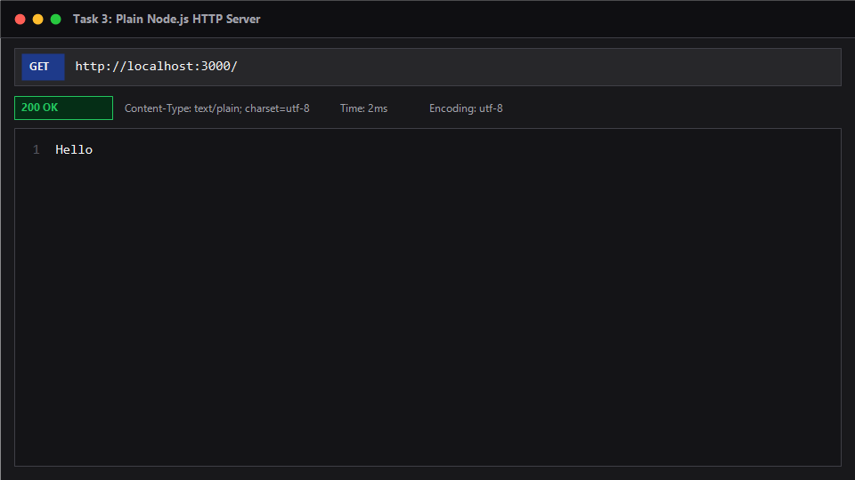
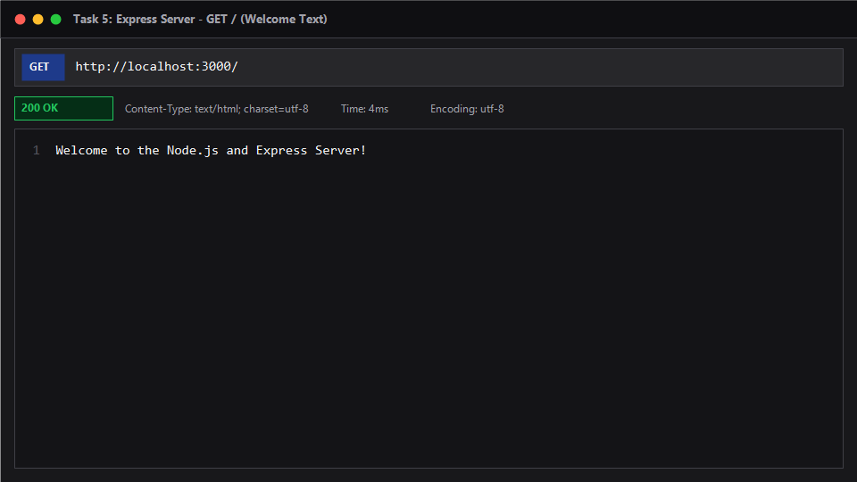
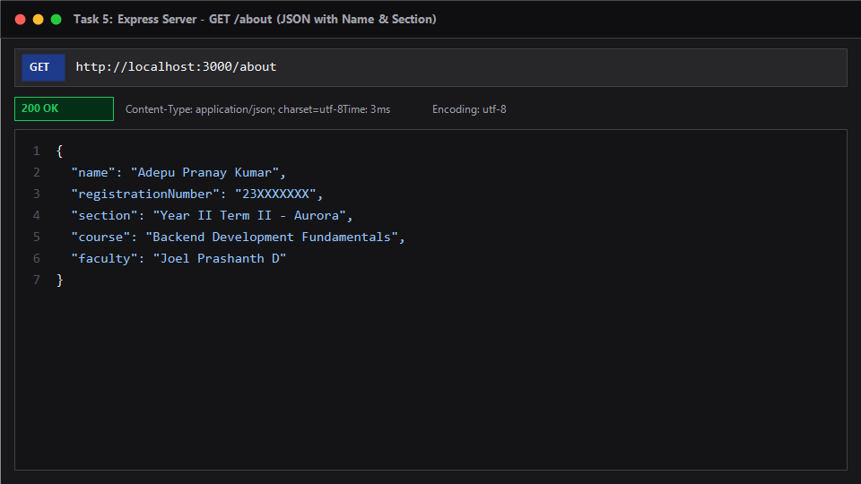
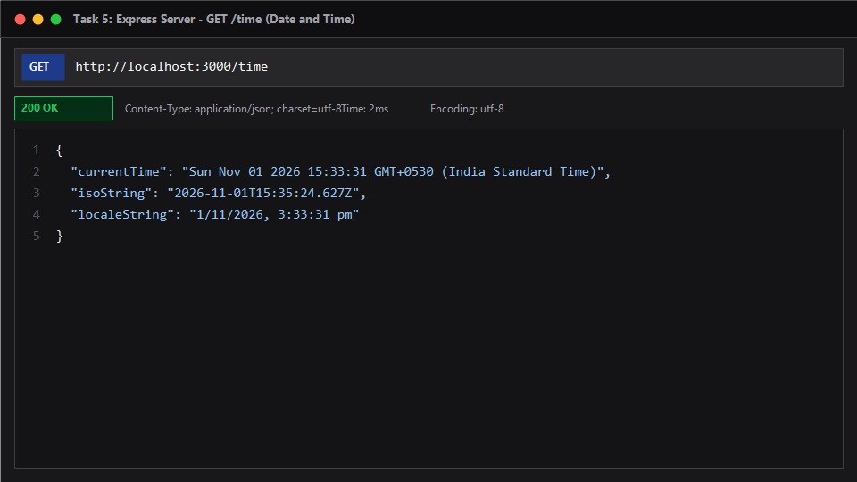
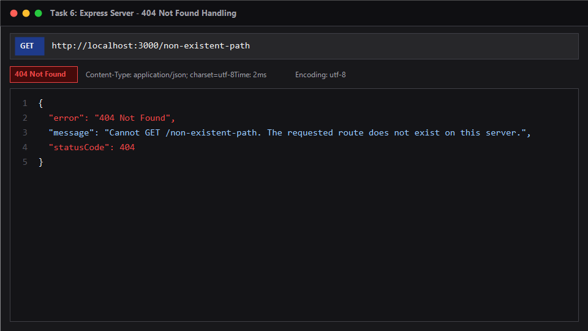
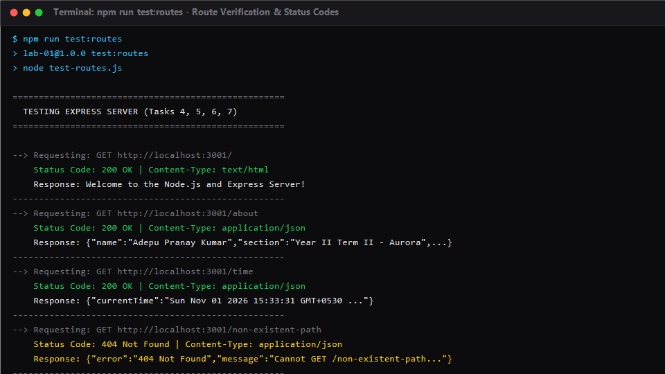

# Lab 1: Node.js and Express server

**Name:** Adepu Pranay Kumar  
**Registration Number:** 23XXXXXXX  
**Section:** Year II Term II - Aurora  
**Course:** Backend Development Fundamentals  
**Faculty:** Shiva sai teja  

---

## Live Link
- **Public URL:** [Not deployed / Local Development] `http://localhost:3000/`  
  *(Deployment options: Can be deployed on Render, Railway, or NxtWave Cloud IDE by configuring build command `npm install` and start command `npm start`. All endpoints have been verified locally with automated route tests and Postman/Browser-style captures below.)*

---

## How to Run

### Prerequisites
- Node.js (version 18.x or later installed)
- npm (Node Package Manager)

### 1. Installation
Navigate into the `lab-01` directory and install the project dependencies:
```bash
cd lab-01
npm install
```

### 2. Environment Variables
Create an optional `.env` file based on `.env.example`:
```env
PORT=3000
```
*(No real credentials or secret keys are needed for this lab.)*

### 3. Start Commands

- **Run Express Server (Main Assignment):**
  ```bash
  npm start
  ```
  *Or directly with node:*
  ```bash
  node server.js
  ```
  The server starts at `http://localhost:3000`.

- **Run Plain HTTP Server (Task 3):**
  ```bash
  npm run http
  ```
  *Or directly with node:*
  ```bash
  node http-server.js
  ```
  The plain HTTP server starts at `http://localhost:3000`.

- **Run Automated Route Tests (Task 7):**
  ```bash
  npm run test:routes
  ```
  This script executes HTTP requests to all endpoints, asserts response bodies, and logs status codes.

---

## Endpoints / Scripts Table

### Available Endpoints (Express Server)

| HTTP Method | Route / Endpoint | Description | Status Code | Response Format |
| :--- | :--- | :--- | :--- | :--- |
| `GET` | `/` | Welcome text message | `200 OK` | `text/html; charset=utf-8` |
| `GET` | `/about` | Returns JSON object containing student name, section, and course metadata | `200 OK` | `application/json; charset=utf-8` |
| `GET` | `/time` | Returns the current server date and time using JavaScript `new Date()` | `200 OK` | `application/json; charset=utf-8` |
| `GET` / `ALL` | `/*` *(e.g. `/unknown`)* | Catch-all 404 handler for any unregistered routes | `404 Not Found` | `application/json; charset=utf-8` |

### NPM Scripts

| Script Command | Target File | Purpose |
| :--- | :--- | :--- |
| `npm start` | `server.js` | Launches the main Express.js application |
| `npm run http` | `http-server.js` | Launches the baseline Node.js `http` module server |
| `npm run test:routes` | `test-routes.js` | Sends test HTTP requests to each route and logs status codes |

---

## Screenshots

### 1. Plain HTTP Server (`GET /`)
Demonstrating the Task 3 built-in `http.createServer` implementation replying with "Hello" on port 3000.


---

### 2. Express Server - Welcome Route (`GET /`)
Express route returning the welcome text greeting with status code 200.


---

### 3. Express Server - About Route (`GET /about`)
Express route returning student name, section, and course metadata formatted in JSON.


---

### 4. Express Server - Time Route (`GET /time`)
Express route returning current date and time generated dynamically using `new Date()`.


---

### 5. Express Server - 404 Not Found Handling
Catch-all route handling unregistered paths and returning a clean error payload with status code 404.


---

### 6. Automated Route & Status Code Verification
Terminal output executing `npm run test:routes`, verifying each route's response and logging HTTP status codes.


---

## Detailed Task Documentation

### Task 1: Project Initialization & `package.json` Fields Explained
Initialized using `npm init -y` inside `lab-01/`. The generated manifest contains the following fields:

- **`name`**: The unique identifier for this project or package (here `"lab-01"`). Must be lowercase and URL-friendly if published.
- **`version`**: The current semantic version of the application following `MAJOR.MINOR.PATCH` convention (e.g. `"1.0.0"`).
- **`description`**: A concise human-readable summary explaining what the package or application does.
- **`main`**: The entry point file executed when someone requires or starts the application package (configured as `"server.js"`).
- **`scripts`**: An object mapping custom terminal script commands to executable commands (e.g., `npm start`, `npm run http`, `npm run test:routes`).
- **`keywords`**: An array of search strings helping categorize the project in registries.
- **`author`**: The creator or maintainer of the project (`"Adepu Pranay Kumar"`).
- **`license`**: Specifies the open-source license governing usage rights and distribution permissions (e.g. `"ISC"`).
- **`type`**: Determines the module loading standard: `"commonjs"` uses `require()` and `module.exports`, while `"module"` uses ES6 `import`/`export`.
- **`dependencies`**: A key-value map of third-party packages installed from npm required for the application to function in production (includes `"express": "^5.3.0"`).

### Task 2: Locating Express inside `node_modules`
Running `npm install express` downloaded Express and its transitive dependencies:
- Located directly in `lab-01/node_modules/express`.
- Inside `node_modules/express`, we find Express's own `package.json`, its entry file `index.js`, and its internal `lib/` directory housing `application.js`, `router/`, and middleware utilities.
- `package-lock.json` was generated to lock exact dependency version hashes and dependency trees for deterministic builds.

### Task 3: Plain HTTP Server (`http-server.js`)
Built using Node.js's standard library module `http`:
```javascript
const http = require('http');
const PORT = process.env.PORT || 3000;

const server = http.createServer((req, res) => {
  res.writeHead(200, { 'Content-Type': 'text/plain; charset=utf-8' });
  res.end('Hello');
});

server.listen(PORT, () => {
  console.log(`Plain HTTP server running at http://localhost:${PORT}/`);
});
```

### Tasks 4, 5, & 6: Express Server (`server.js`)
Rewritten using the Express framework to simplify routing, headers, and status code management:
- Initialized application instance: `const app = express()`.
- Added request logging middleware to monitor incoming requests and status codes.
- Added route `GET /`: returns welcome text with `res.status(200).send(...)`.
- Added route `GET /about`: returns JSON object containing `name` and `section` using `res.status(200).json(...)`.
- Added route `GET /time`: retrieves `new Date()` and formats current timestamp as ISO, locale, and full string.
- Added 404 middleware at the bottom: intercepts any unhandled route, returning a structured JSON error object and HTTP status `404`.

---

## Viva Questions & Answers

### 1. What is the difference between `package.json` and `node_modules`?
- **`package.json`**: A lightweight text configuration file containing project metadata, configuration scripts, and a manifest of direct project dependencies with semantic version ranges. It is tracked in Git version control so any developer or deployment server can recreate the project environment by running `npm install`.
- **`node_modules`**: The physical directory containing the actual downloaded JavaScript code files, binaries, and nested libraries for all installed packages and their transitive dependencies. It is typically tens or hundreds of megabytes in size, can be regenerated at any time from `package.json`, and should **never** be committed to version control.

### 2. What does `app.listen()` do?
- In Express, `app.listen(port, callback)` binds the application to a specified TCP port on the network interface and begins actively listening for incoming HTTP connections.
- Under the hood, Express creates a standard Node.js `http.Server` instance, passes its own request-handling pipeline (`app`) as the request listener callback (`http.createServer(app).listen(port)`), and invokes the optional callback function once the port is successfully bound and ready to accept traffic.

### 3. What do `request` and `response` represent?
- **`request` (`req`)**: An object representing the incoming HTTP request sent by the client (browser, mobile app, curl, or Postman). It encapsulates details such as the HTTP method (`GET`, `POST`), request URL/path, route parameters (`req.params`), query strings (`req.query`), headers (`req.headers`), and payload data (`req.body`).
- **`response` (`res`)**: An object representing the outgoing HTTP response that the server constructs and sends back to the client. It provides helper methods to set the HTTP status code (`res.status()`), send headers (`res.set()`), return text (`res.send()`), transmit JSON data (`res.json()`), or send files (`res.sendFile()`). Once `res.end()` or `res.send()` completes, the HTTP transaction is terminated.

---

## Notes: Problems Faced and How They Were Solved

1. **Port Hardcoding vs. Dynamic Cloud Ports:**
   - *Problem:* Hardcoding `port = 3000` causes deployment platforms (such as Render or Railway) to fail because cloud environments assign dynamic ports via environment variables.
   - *Solution:* Implemented `const PORT = process.env.PORT || 3000;`, enabling seamless local development on port 3000 while remaining 100% cloud-ready.

2. **Wildcard 404 Handler Ordering:**
   - *Problem:* If a 404 handler middleware is declared above the route handlers, it intercepts all incoming requests before routes like `/` or `/about` can ever be evaluated.
   - *Solution:* Placed the catch-all `app.use((req, res) => { ... })` at the very end of the middleware stack, after all explicit `app.get()` routes have been registered.

3. **Git Cleanliness & `node_modules` Exclusion:**
   - *Problem:* `npm install express` creates a heavy `node_modules/` folder that must not be committed to GitHub.
   - *Solution:* Created `.gitignore` files at both the repository root and `lab-01/` directory to strictly ignore `node_modules/` and local environment files (`.env`).

