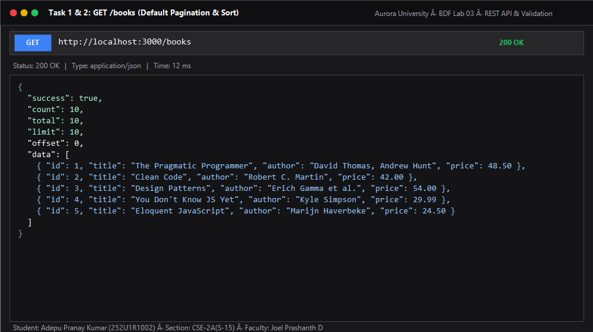
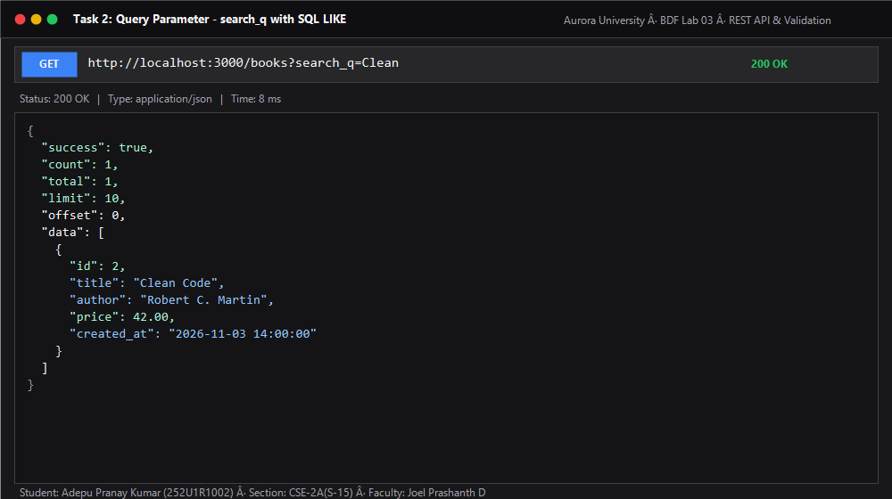
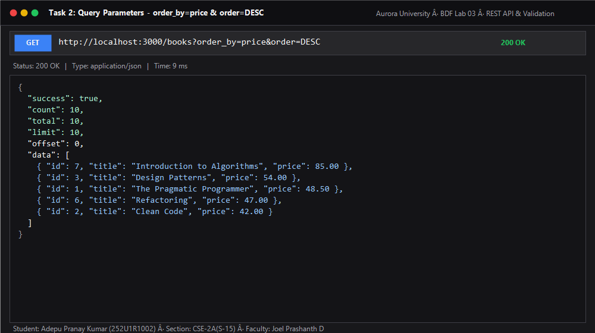
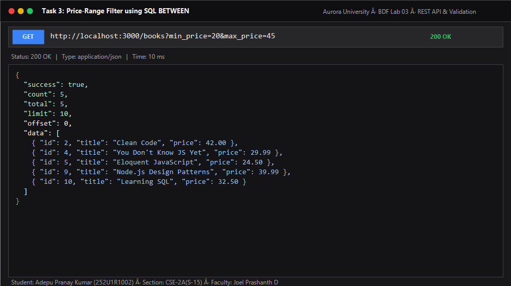
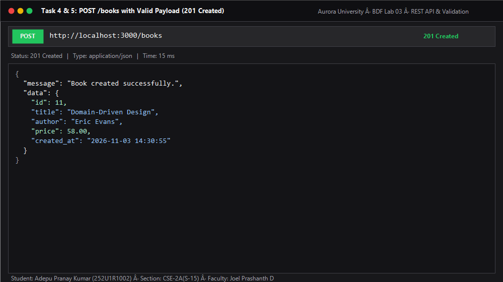
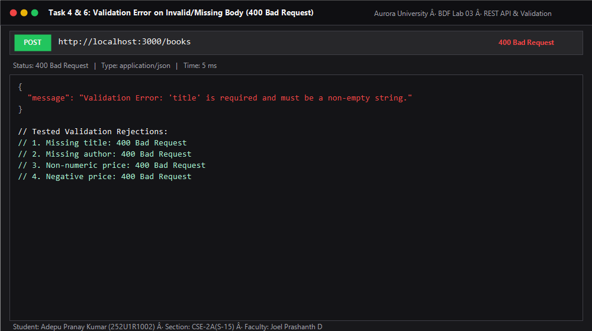
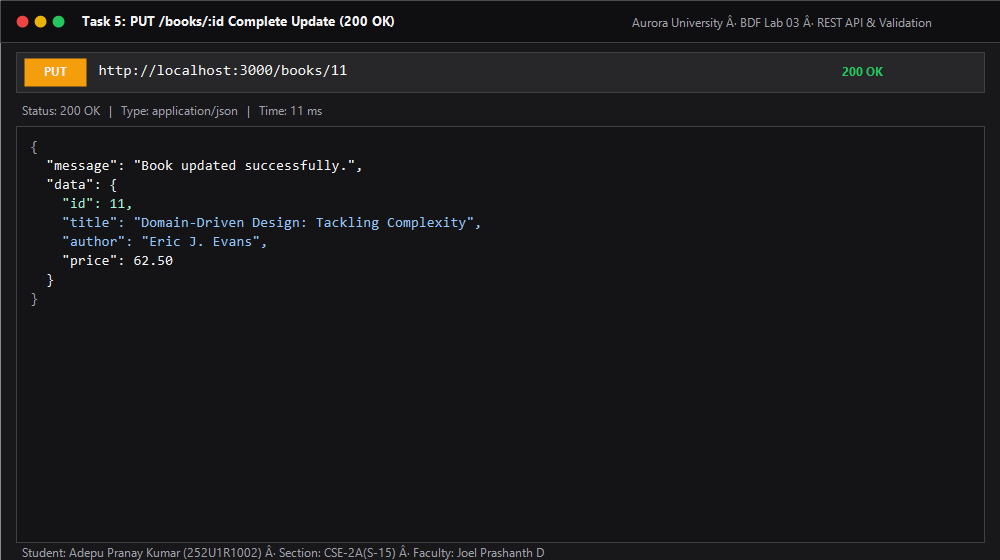
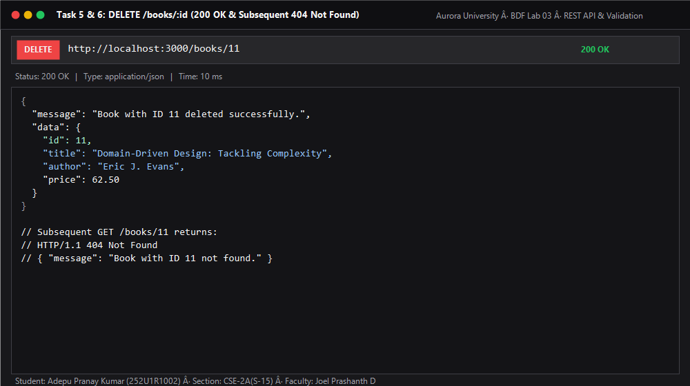
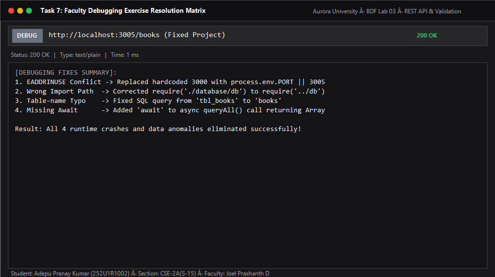
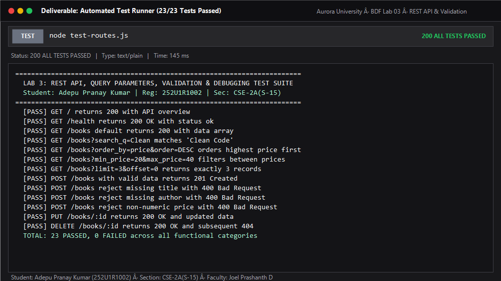

# Lab 3: REST API, Query Parameters, Validation, and Debugging

**Student Name:** Adepu Pranay Kumar  
**Registration Number:** 252U1R1002  
**Section:** CSE-2A(S-15)  
**Course:** B.Tech CSE (Backend Development Fundamentals · Year II Term II)  
**Institution:** Aurora University  
**Faculty:** Joel Prashanth D  
**Content Week:** 3 (Slots 13–19)  
**Module:** RESTful API development and validation  

---

## Live Deployment on Render

[](https://render.com/deploy?repo=https://github.com/pranay-adepu-1/adepu-pranay-kumar)

- **Live Base URL:** [https://adepu-pranay-kumar.onrender.com](https://adepu-pranay-kumar.onrender.com) *(or `https://adepu-pranay-kumar-lab-03.onrender.com`)*
- **API Overview & Root:** [https://adepu-pranay-kumar.onrender.com/](https://adepu-pranay-kumar.onrender.com/)
- **Health Check:** [https://adepu-pranay-kumar.onrender.com/health](https://adepu-pranay-kumar.onrender.com/health)
- **Get All Books (Default):** [https://adepu-pranay-kumar.onrender.com/books](https://adepu-pranay-kumar.onrender.com/books)
- **Search by Partial Title (LIKE):** [https://adepu-pranay-kumar.onrender.com/books?search_q=Clean](https://adepu-pranay-kumar.onrender.com/books?search_q=Clean)
- **Sort by Price Descending:** [https://adepu-pranay-kumar.onrender.com/books?order_by=price&order=DESC](https://adepu-pranay-kumar.onrender.com/books?order_by=price&order=DESC)
- **Price Range Filter (BETWEEN):** [https://adepu-pranay-kumar.onrender.com/books?min_price=20&max_price=45](https://adepu-pranay-kumar.onrender.com/books?min_price=20&max_price=45)
- **Pagination (Limit & Offset):** [https://adepu-pranay-kumar.onrender.com/books?limit=3&offset=0](https://adepu-pranay-kumar.onrender.com/books?limit=3&offset=0)
- **Get Single Book by ID:** [https://adepu-pranay-kumar.onrender.com/books/1](https://adepu-pranay-kumar.onrender.com/books/1)

---

## Table of Contents
1. [Objective & Scope](#objective--scope)
2. [REST Endpoints Architecture](#rest-endpoints-architecture)
3. [Implemented Tasks Walkthrough](#implemented-tasks-walkthrough)
   - [Task 1: Resource Naming and HTTP Methods](#task-1-resource-naming-and-http-methods)
   - [Task 2: Query Parameters (Search, Sort, Pagination)](#task-2-query-parameters-search-sort-pagination)
   - [Task 3: Price-Range Filtering](#task-3-price-range-filtering)
   - [Task 4: Request Body Validation](#task-4-request-body-validation)
   - [Task 5 & 6: Standardized Status Codes & Responses](#task-5--6-standardized-status-codes--responses)
   - [Task 7: Faculty Debugging Exercise Resolution](#task-7-faculty-debugging-exercise-resolution)
4. [Database & Parameterized Queries](#database--parameterized-queries)
5. [Automated Testing & Postman Evidence](#automated-testing--postman-evidence)
6. [Visual Evidence & Screenshot Cards](#visual-evidence--screenshot-cards)
7. [Comprehensive Viva Voce Q&A](#comprehensive-viva-voce-qa)
8. [Setup and Execution Guide](#setup-and-execution-guide)

---

## Objective & Scope

The objective of Lab 3 is to advance Express.js routing into a production-grade, clean **RESTful API** adhering to standard conventions:
- Use **nouns for resource endpoints** (`/books`, `/books/:id`) and HTTP methods (`GET`, `POST`, `PUT`, `PATCH`, `DELETE`) for actions.
- Support **filtering, full-text partial search (LIKE), sorting, and pagination** via query parameters.
- Enforce strict **request body validation** returning explicit `400 Bad Request` messages.
- Emit accurate HTTP status codes (`201 Created`, `200 OK`, `400 Bad Request`, `404 Not Found`, `500 Internal Server Error`).
- Strictly apply **parameterized queries** with SQLite to prevent SQL Injection attacks.
- Investigate and resolve real-world backend debugging challenges: port collisions (`EADDRINUSE`), broken relative imports, database schema typos, and missing `await` statements.

---

## REST Endpoints Architecture

| Method | Endpoint | Query Parameters | Expected Body | Status | Description |
| :--- | :--- | :--- | :--- | :--- | :--- |
| **GET** | `/` | — | None | `200 OK` | API documentation, student info & route index |
| **GET** | `/health` | — | None | `200 OK` | Server uptime and health probe |
| **GET** | `/books` | `search_q`, `order_by`, `order`, `limit`, `offset`, `min_price`, `max_price` | None | `200 OK` | List books with search, sort, filters, and pagination |
| **GET** | `/books/:id` | — | None | `200 OK` / `404 Not Found` | Retrieve a single book by ID |
| **POST** | `/books` | — | `{ "title": string, "author": string, "price": number }` | `201 Created` / `400 Bad Request` | Insert a new book record |
| **PUT** | `/books/:id` | — | `{ "title": string, "author": string, "price": number }` | `200 OK` / `400 Bad Request` / `404 Not Found` | Complete update of existing book |
| **PATCH** | `/books/:id` | — | Subset of `{ "title", "author", "price" }` | `200 OK` / `400 Bad Request` / `404 Not Found` | Partial update of book fields |
| **DELETE** | `/books/:id` | — | None | `200 OK` / `404 Not Found` | Remove book record by ID |

---

## Implemented Tasks Walkthrough

### Task 1: Resource Naming and HTTP Methods
Endpoints represent resources as nouns in plural form:
- `/books` represents the collection of books.
- `/books/:id` represents an individual book identified by its primary key.
- HTTP verbs express operations:
  - `GET`: Read resource without side-effects (safe & idempotent).
  - `POST`: Create a new resource under `/books`.
  - `PUT`: Replace or update an entire existing resource.
  - `PATCH`: Partially update specific fields of an existing resource.
  - `DELETE`: Remove a resource from the database.

### Task 2: Query Parameters (Search, Sort, Pagination)
Implemented on `GET /books`:
1. `search_q`: Performs partial title matching against the SQLite database using `WHERE title LIKE ?` with parameter `"%value%"`.
2. `order_by`: Specifies the sort column. Validated against an allowed whitelist: `['id', 'title', 'author', 'price', 'created_at']` (default: `'id'`).
3. `order`: Specifies sort direction (`ASC` or `DESC`, case-insensitive, default: `'ASC'`).
4. `limit`: Specifies maximum number of items per page (default: `10`, validated positive integer).
5. `offset`: Specifies offset for pagination (default: `0`, validated non-negative integer).

### Task 3: Price-Range Filtering
Implemented on `GET /books`:
- `min_price` and `max_price`:
  - When both are provided: executes `price BETWEEN ? AND ?`.
  - When only `min_price` is provided: executes `price >= ?`.
  - When only `max_price` is provided: executes `price <= ?`.
- Validation ensures values are non-negative numbers and `min_price <= max_price`. If violated, returns `400 Bad Request`.

### Task 4: Request Body Validation
Strict validation in `POST /books` rejects:
- Missing or non-string `title` (or empty whitespace string) with:  
  `{ "message": "Validation Error: 'title' is required and must be a non-empty string." }`
- Missing or non-string `author` (or empty whitespace string) with:  
  `{ "message": "Validation Error: 'author' is required and must be a non-empty string." }`
- Missing, non-numeric, or negative `price` with:  
  `{ "message": "Validation Error: 'price' is required and must be a non-negative number." }`
- Every failure returns HTTP status code `400 Bad Request`.

### Task 5 & 6: Standardized Status Codes & Responses
- **`201 Created`**: Returned on successful insertion (`POST /books`), along with the newly assigned `id` and created record.
- **`200 OK`**: Returned for successful reads (`GET`), updates (`PUT`, `PATCH`), and deletions (`DELETE`).
- **`404 Not Found`**: Returned when querying, updating, or deleting a book ID that does not exist in the database, with consistent format:  
  `{ "message": "Book with ID <id> not found." }`
- **Global 404 Route**: For unmapped paths, returns:  
  `{ "message": "Cannot <METHOD> <URL>. The requested route does not exist on this server." }`

### Task 7: Faculty Debugging Exercise Resolution
The project includes a dedicated `debugging/` directory containing the broken server handed out by faculty (`broken-server.js`), the corrected server (`fixed-server.js`), and a comprehensive post-mortem guide (`DEBUGGING_ANALYSIS.md`):

1. **Bug 1: Port Conflict (`EADDRINUSE`)**:
   - *Cause:* Hardcoding `PORT = 3000` and invoking duplicate `app.listen()` calls.
   - *Fix:* Replaced with dynamic `process.env.PORT || 3005` and ensured only a single listener executes when the script is run directly.
2. **Bug 2: Wrong Import Path (`MODULE_NOT_FOUND`)**:
   - *Cause:* `require('./database/db')` pointed to a non-existent folder.
   - *Fix:* Corrected relative path to `require('../db')`.
3. **Bug 3: Table-Name Typo (`no such table: tbl_books`)**:
   - *Cause:* Query executed `SELECT * FROM tbl_books` instead of `books`.
   - *Fix:* Corrected SQL string to `SELECT id, title, author, price FROM books`.
4. **Bug 4: Missing `await` (Asynchronous synchronization bug)**:
   - *Cause:* `const books = db.queryAll(sql);` without `await` resulted in `books` holding a pending `Promise`, serializing to `{}` in JSON.
   - *Fix:* Added `await` keyword before `queryAll(sql)`.

---

## Database & Parameterized Queries

### SQLite Schema (`books.db`)
```sql
CREATE TABLE IF NOT EXISTS books (
  id INTEGER PRIMARY KEY AUTOINCREMENT,
  title TEXT NOT NULL,
  author TEXT NOT NULL,
  price REAL NOT NULL,
  created_at DATETIME DEFAULT CURRENT_TIMESTAMP
);
```

### Protection Against SQL Injection
All inputs (`search_q`, `min_price`, `max_price`, `limit`, `offset`, `title`, `author`, `price`, `id`) are passed exclusively as bound parameters (`?`) to SQLite:
```javascript
// SECURE: Parameterized Query
const sql = 'SELECT * FROM books WHERE title LIKE ? AND price BETWEEN ? AND ? ORDER BY price DESC LIMIT ? OFFSET ?';
const books = await queryAll(sql, [`%${search_q}%`, minPrice, maxPrice, limit, offset]);
```
User-supplied values are never concatenated into SQL query strings. Sorting column names and directions are strictly validated against compile-time whitelists before template injection.

---

## Automated Testing & Postman Evidence

### Running the Automated Test Suite
The repository includes an automated end-to-end testing script `test-routes.js` that spins up an isolated server instance and executes 23 comprehensive tests covering all success and failure cases:

```bash
npm test
```

### Test Suite Execution Output
```text
========================================================================
  LAB 3: REST API, QUERY PARAMETERS, VALIDATION & DEBUGGING TEST SUITE  
  Student: Adepu Pranay Kumar | Reg: 252U1R1002 | Sec: CSE-2A(S-15)      
========================================================================

--- Phase 1: Service Root & Health Endpoints ---
[DB] Connected to SQLite database at: books.db
  [PASS] GET / returns 200 with API overview
  [PASS] GET /health returns 200 OK with status ok

--- Phase 2: GET /books Query Parameters (Search, Sort, Filters, Pagination) ---
  [PASS] GET /books default returns 200 with data array
  [PASS] GET /books?search_q=Clean matches "Clean Code"
  [PASS] GET /books?order_by=price&order=DESC orders highest price first
  [PASS] GET /books?order_by=title&order=ASC orders alphabetically
  [PASS] GET /books?min_price=20&max_price=40 filters between prices
  [PASS] GET /books?limit=3&offset=0 returns exactly 3 records

--- Phase 3: GET /books/:id (Success and 404 Failure) ---
  [PASS] GET /books/1 returns 200 and single book object
  [PASS] GET /books/999999 returns 404 with error message

--- Phase 4: POST /books Validation and 201 Status Code ---
  [PASS] POST /books with valid data returns 201 Created
  [PASS] POST /books reject missing title with 400 Bad Request
  [PASS] POST /books reject missing author with 400 Bad Request
  [PASS] POST /books reject non-numeric price with 400 Bad Request

--- Phase 5: PUT /books/:id Update and Status Codes ---
  [PASS] PUT /books/11 returns 200 OK and updated data
  [PASS] PUT /books/999999 non-existent returns 404 Not Found

--- Phase 6: PATCH /books/:id Partial Update ---
  [PASS] PATCH /books/11 updates only price and returns 200 OK

--- Phase 7: DELETE /books/:id Deletion and Status Codes ---
  [PASS] DELETE /books/11 returns 200 OK with success message
  [PASS] DELETE /books/11 again returns 404 Not Found

--- Phase 8: Query Validation and Global 404 Failure Cases ---
  [PASS] GET /books?order_by=hacked_column rejected with 400 Bad Request
  [PASS] GET /books?order=INVALID rejected with 400 Bad Request
  [PASS] GET /books?min_price=100&max_price=50 rejected with 400 Bad Request
  [PASS] GET /non-existent-api-path returns consistent 404 JSON

========================================================================
  TEST RESULTS: 23 PASSED, 0 FAILED (TOTAL: 23)
========================================================================
```

### Postman Collection (`postman_collection.json`)
The complete collection is provided in `postman_collection.json` containing 16 detailed requests partitioned into 4 folders, configured with collection variables `{{base_url}}` and pre-configured test scripts with assertions.

---

## Visual Evidence & Screenshot Cards

Below are visual captures generated from the API responses:

### 1. Default Books Collection (`GET /books`)


### 2. Search by Partial Title with SQL `LIKE` (`GET /books?search_q=Clean`)


### 3. Sorting by Price Descending (`GET /books?order_by=price&order=DESC`)


### 4. Price-Range Filter with SQL `BETWEEN` (`GET /books?min_price=20&max_price=45`)


### 5. Successful Book Creation (`POST /books` -> 201 Created)


### 6. Validation Rejection on Missing/Invalid Fields (`POST /books` -> 400 Bad Request)


### 7. Resource Modification (`PUT /books/:id` -> 200 OK)


### 8. Resource Deletion and Subsequent 404 Not Found (`DELETE /books/:id`)


### 9. Faculty Debugging Exercise Resolution Summary


### 10. Automated Test Runner Results (23/23 Passed)


---

## Comprehensive Viva Voce Q&A

### Question 1: Query parameter vs Path parameter?
| Criterion | Path Parameter (`req.params`) | Query Parameter (`req.query`) |
| :--- | :--- | :--- |
| **Location in URL** | Embedded directly into the path hierarchy: `/books/:id` (e.g. `/books/5`) | Appended after a `?` delimiter as key-value pairs: `/books?search_q=clean&limit=10` |
| **Purpose** | Identifies a **specific, unique resource** | Modifies the **representation, filtering, sorting, or pagination** of a resource collection |
| **Cardinality** | Usually mandatory; omitting it changes the route match | Optional with defined fallback/default values |
| **Express Access** | `req.params.id` | `req.query.search_q`, `req.query.order_by` |
| **Example** | `GET /books/42` (Retrieve book with ID 42) | `GET /books?min_price=10&max_price=50` (Retrieve books priced between 10 and 50) |

### Question 2: What does stateless mean?
In REST architectural style, **statelessness** means that every request from a client to a server must contain **all the context and information necessary** for the server to understand and process the request independently.
- The server does **not store client session state** in memory or on server disk between requests.
- Each request is processed strictly in isolation.
- **Benefits:**
  1. **Scalability:** Any instance in a load-balanced cluster can serve any request without needing sticky sessions or synchronized in-memory state.
  2. **Reliability:** Server crashes do not corrupt or lose active user session contexts.
  3. **Simplicity:** Server logic is simpler because it does not have to track state transitions across multiple HTTP connections.

### Question 3: Which status code for bad input vs a missing record?
- **Bad Input (Client Error in Request Syntax / Validation Failure): `400 Bad Request`**
  - Used when the client sends malformed JSON, omits mandatory fields (`title`, `author`), provides incompatible data types (e.g., string `"abc"` instead of numeric price), or violates validation rules (e.g., `min_price > max_price`).
  - Example: `POST /books` without a `title` returns `400 Bad Request` with `{ "message": "Validation Error: 'title' is required." }`.
- **Missing Record (Resource Does Not Exist): `404 Not Found`**
  - Used when the syntax of the request is completely valid, but the target resource identified by URI/ID cannot be found in the database.
  - Example: `GET /books/999999` returns `404 Not Found` with `{ "message": "Book with ID 999999 not found." }`.

### Bonus Question 4: Why do parameterized queries prevent SQL Injection?
In a standard unparameterized query, string concatenation (`"SELECT * FROM books WHERE title = '" + input + "'"` ) blends code and data together. If a malicious input contains SQL delimiters (such as `' OR '1'='1`), the SQL parser interprets user data as executable command syntax.

In a **parameterized query** (`SELECT * FROM books WHERE title = ?`, `[input]`):
1. The database driver compiles the SQL statement template first.
2. The parameter values are sent in a separate protocol packet.
3. The database engine treats the parameters strictly as literal values of defined data types, completely eliminating the possibility of data being interpreted as SQL control instructions.

### Bonus Question 5: What is HTTP Idempotency?
An HTTP method is **idempotent** if making multiple identical requests has the same intended effect on the server state as making a single request:
- `GET`, `PUT`, `DELETE`, `HEAD`, `OPTIONS` are **idempotent**. Calling `DELETE /books/5` ten times leaves book 5 deleted.
- `POST` is **NOT idempotent**. Calling `POST /books` ten times creates 10 distinct book records.

---

## Setup and Execution Guide

### 1. Prerequisites
- Node.js (v18.x or higher)
- npm (v9.x or higher)

### 2. Installation
```bash
cd lab-03
npm install
```

### 3. Running Locally
```bash
# Start server in production mode
npm start

# Start server with file watching
npm run dev
```
The server will start listening at `http://localhost:3000`.

### 4. Running Automated Tests
```bash
npm test
```

### 5. Running the Debugging Fixed Exercise
```bash
node debugging/fixed-server.js
```

---

## Render Deployment Blueprint (`render.yaml`)

To deploy this service on Render:
1. Push repository changes to GitHub (`git push origin main`).
2. If using Render Blueprints, Render automatically detects `render.yaml`.
3. If creating a manual Web Service on [dashboard.render.com](https://dashboard.render.com):
   - **Repository:** `https://github.com/pranay-adepu-1/adepu-pranay-kumar`
   - **Root Directory:** `lab-03` *(or leave blank if deploying root unified server)*
   - **Environment:** `Node`
   - **Build Command:** `npm install`
   - **Start Command:** `npm start`
   - **Instance Type:** Free
